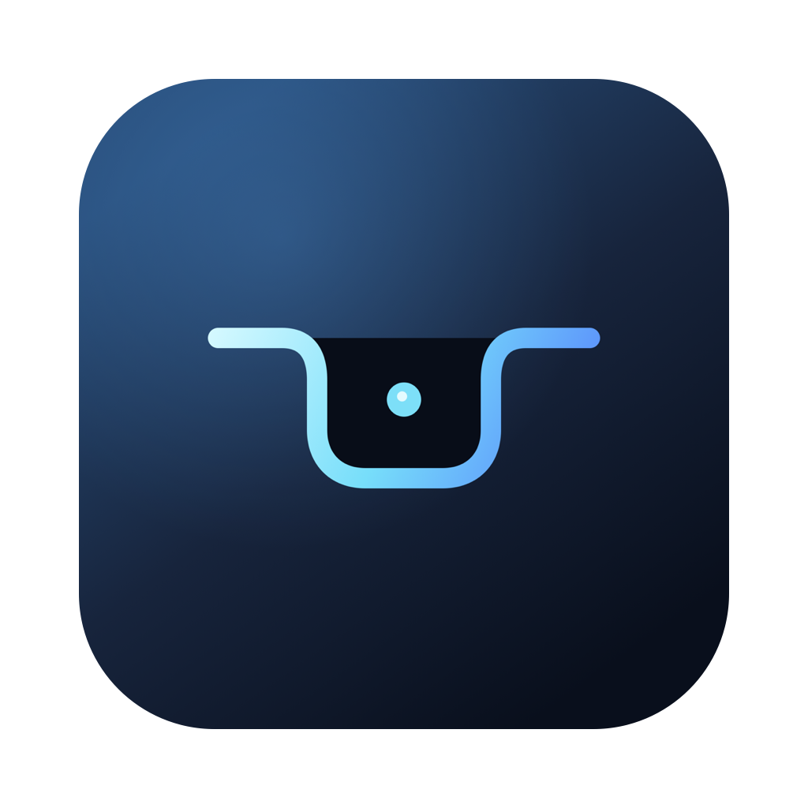

<p align="center">
  
</p>

<h1 align="center">Dynamic Bangs</h1>

<p align="center">
  <strong>让 Mac 刘海真正派上用场的灵动岛工作台 —— 音乐、番茄钟、今日任务、全局搜索与文件暂存架。</strong>
</p>

<p align="center">
  
  
  <a href="LICENSE"></a>
</p>

---

## 功能特性

- **贴合实体刘海与菜单栏避让**：紧凑态贴合屏幕顶部并居于物理刘海两侧，自动检测右侧状态栏图标并避让拥挤区域；展开态工作台始终位于菜单栏下方，不会遮挡系统菜单。
- **紧凑态轻量交互**：悬停、双击刘海即可展开工作台；支持全屏应用/Safari 地址栏自动避让，空闲时隐藏且自动穿透点击。
- **音乐控制（网易云音乐 / Apple Music / Spotify）**：支持播放/暂停、切歌、进度拖动、专辑封面取色与实时 32 频段音频频谱（CoreAudio Process Tap，2048-point FFT），并集成 `mediaremote-adapter` 支持网易云音乐等播放器。
- **番茄钟（Pomodoro）**：自定义专注/休息预设、自动衔接循环、结束后提示音，可在紧凑态显示倒计时。
- **今日任务（Daily Tasks）**：在工作台内快速记录与勾选每日待办，进度同步展示在刘海。
- **全局快捷搜索（`⌥⌘K`）**：一键快速启动常用应用、系统功能与快捷操作。
- **文件暂存架（Shelf）**：将文件拖放到刘海暂存，随时拖出使用；基于安全书签持久化并缓存 QuickLook 缩略图。
- **系统 HUD 与动态提示**：支持在刘海内替代系统音量/亮度浮层、显示充电/耳机切换/专注模式提示，以及 `⌥⌘S` 全屏音频频谱防锁屏守护。
- **纯本地、零联网**：无遥测、无分析统计、无网络请求，音频频谱与任务数据完全在本地处理。

## 系统要求

| 项目 | 说明 |
|---|---|
| **macOS 14.0+** | 应用最低运行版本 |
| **macOS 14.4+** | 实时音频频谱所需（低版本自动回退为平滑动画） |
| **Apple Silicon (`arm64`)** | 当前本地构建脚本面向 Apple Silicon Mac |
| **有无物理刘海均可** | 无刘海屏幕会自动绘制虚拟刘海区域 |

## 安装方式

1. 下载最新的 `.dmg` 安装包（或本地构建后打包）。
2. 双击打开 `.dmg`，将 **`Dynamic Bangs.app`** 拖入 **`Applications`** 文件夹。
3. 体验版使用临时签名。首次打开若提示无法验证开发者，请核对安装包来源，再参照 [Apple 安装指南](https://support.apple.com/zh-cn/102445)。

安装包包含两份原始许可证。Dynamic Bangs 沿用 CoteDOs 的应用标识和数据目录，已有 CoteDOs 时请择一运行。

## 权限说明

按需申请，不使用对应功能时无需开启：

| 权限 | 作用 |
|---|---|
| **自动化 (Automation)** | 控制 Apple Music / Spotify、读取浏览器标签页与执行快捷操作 |
| **辅助功能 (Accessibility)** | 接管音量/亮度按键 HUD、检测全屏地址栏与左侧菜单栏宽度 |
| **音频录制 (Audio Recording)** | CoreAudio Process Tap 实时音频频谱分析（数据不落盘、不上传） |

> 本地重新编译覆盖安装后，如果辅助功能权限失效，请在「系统设置 → 隐私与安全性 → 辅助功能」中移除旧条目后重新勾选。

## 从源码构建与打包

无需完整 Xcode IDE，仅需 Xcode Command Line Tools (`swiftc` / `clang` / `iconutil` / `codesign`)：

```sh
# 1. 构建并签名 build/Dynamic Bangs.app
python3 Tools/build-local.py

# 2. 打包为可分发 DMG（输出至 build/release/）
bash Tools/package-dmg.sh

# 3. 运行内置测试套件
bash Tools/run-tests.sh
```

## 卸载与重置数据

```sh
rm -rf "/Applications/Dynamic Bangs.app"
rm -rf ~/Library/Application\ Support/NotchMate ~/Library/Caches/NotchMate
defaults delete com.scott.notchmate
tccutil reset AudioCapture com.scott.notchmate
```

## 开源致谢与许可

本项目基于以下开源项目二次开发与集成，特此致谢并保留原许可证：

- **[Scxttk/CoteDOs](https://github.com/Scxttk/CoteDOs)** — MIT License（Copyright © 2026 Scott Koehler），详见 [LICENSE](LICENSE)。
- **[ungive/mediaremote-adapter](https://github.com/ungive/mediaremote-adapter)** — BSD 3-Clause License（Copyright © 2025 Jonas van den Berg and contributors），详见 [Vendor/mediaremote-adapter/LICENSE](Vendor/mediaremote-adapter/LICENSE) 与 [Vendor/mediaremote-adapter/UPSTREAM.txt](Vendor/mediaremote-adapter/UPSTREAM.txt)。
